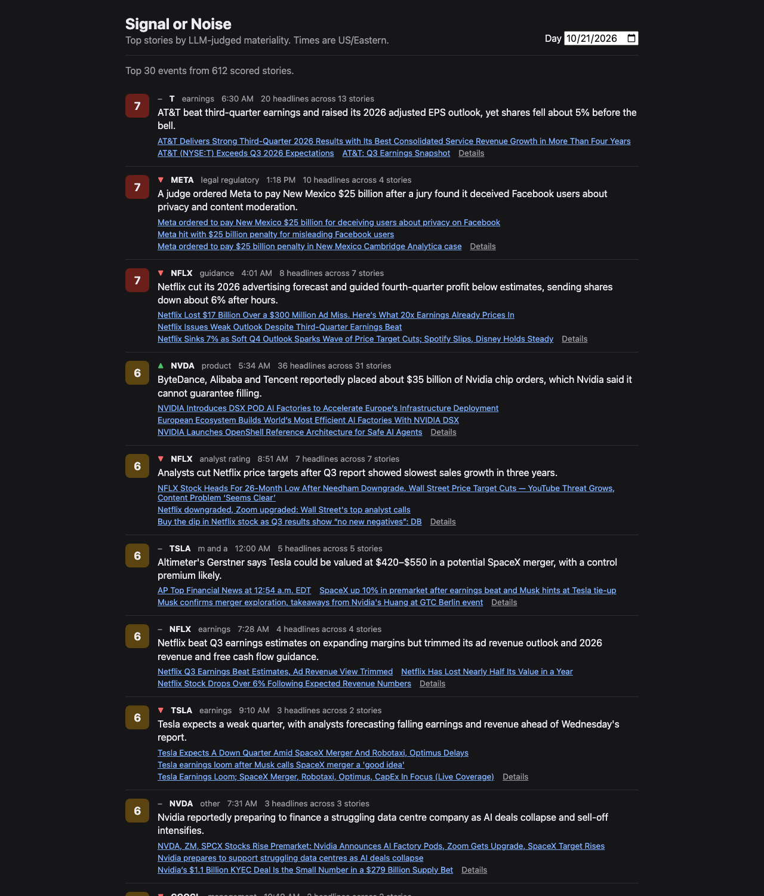
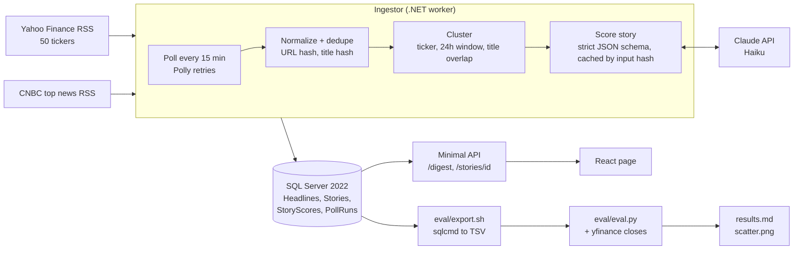

# Signal or Noise

Collapses a day of financial headlines into ~30 ranked stories, each with an LLM materiality score and a one-line summary, then measures whether those scores actually predict price moves.

> Status: complete pipeline, live data collection in progress. Eval numbers below are preliminary until 1–2 weeks of headlines are in. See [PLAN.md](PLAN.md) for the full spec.



## Architecture



**No lookahead, end to end.** Each story is scored only on headlines published within 30 minutes of its first headline (`ScoredAsOfUtc`), and the prompt tells the model not to treat a headline that only reports the stock's own price move as news. The eval measures returns from the close before that cutoff, and the trailing volatility it normalizes by uses only earlier sessions.

| Project | Role |
|---|---|
| `src/SignalOrNoise.Core` | EF Core entities, `NewsDbContext`, migrations |
| `src/SignalOrNoise.Ingestor` | Worker service: polls RSS, dedupes, stores headlines |
| `src/SignalOrNoise.Api` | ASP.NET Core Minimal API serving the digest |
| `tests/SignalOrNoise.Tests` | xUnit tests |
| `web/` | React + Vite + TypeScript digest page _(M3)_ |
| `eval/` | Python eval of scores vs. abnormal returns _(M4)_ |

## Prerequisites

- .NET 10 SDK
- Docker Desktop (on Apple Silicon: enable "Use Rosetta for x86_64/amd64 emulation")

## Configuration and secrets

No secret is stored in the repo. Each one lives outside git:

| Setting | Used by | Where it lives |
|---|---|---|
| `MSSQL_SA_PASSWORD` | Docker (SQL Server) | `.env` in the repo root (gitignored; copy from `.env.example`) |
| `ConnectionStrings__Default` | Ingestor, API, `dotnet ef` | Environment variable, exported per terminal (step 2 below) |
| `ANTHROPIC_API_KEY` | Story scoring (Claude API) | Environment variable exported from `~/.zshrc`, outside the repo |

To set the API key, add this line to the bottom of `~/.zshrc`, then run `source ~/.zshrc` (new terminals load it automatically):

```bash
export ANTHROPIC_API_KEY="sk-ant-..."
```

Check it without printing the key: `echo ${ANTHROPIC_API_KEY:0:7}` should print `sk-ant-`. The .NET apps don't read `.env`, so the key doesn't go there.

## Run locally

```bash
# 1. Start SQL Server
cp .env.example .env            # then edit the password
docker compose up -d
docker compose ps               # wait until sqlserver shows (healthy)

# 2. Point the apps and EF tooling at it (same password as .env)
export ConnectionStrings__Default="Server=localhost,1433;Database=SignalOrNoise;User Id=sa;Password=<your password>;TrustServerCertificate=True"

# 3. Create the schema
dotnet tool restore
dotnet ef database update --project src/SignalOrNoise.Core

# 4. Run
dotnet run --project src/SignalOrNoise.Ingestor   # polls feeds every 15 min; clusters and scores if ANTHROPIC_API_KEY is set
dotnet run --project src/SignalOrNoise.Api        # serves http://localhost:5199

# 5. Web page (separate terminal; forwards /digest and /stories to the API)
cd web
npm install
npm run dev                                       # open http://localhost:5173

# Tests
dotnet test
```

## API

| Endpoint | Returns |
|---|---|
| `GET /digest?date=YYYY-MM-DD` | Top 30 events for that US/Eastern day (default: today), ranked by materiality. Stories with the same primary ticker and event type are merged into one row. |
| `GET /stories/{id}` | One story's score, rationale, and every member headline, marked by whether the scorer saw it (published before the cutoff). |
| `GET /health` | `"ok"` if the database is reachable. |

## Collect data continuously

The eval needs days of headlines, and each Yahoo feed only holds its newest ~13–20 items (under an hour for the busiest tickers during market hours), so leave the Ingestor running. On a Mac, `caffeinate -i` keeps the machine from idle-sleeping while it runs. Closing the lid still sleeps it; the process resumes on wake, but headlines that rolled off a feed in the meantime are lost.

```bash
# Run in the background, surviving the terminal closing (needs the env vars from "Run locally")
nohup caffeinate -i dotnet run --project src/SignalOrNoise.Ingestor >> ~/Library/Logs/signal-or-noise/ingestor.log 2>&1 &

pgrep -fl SignalOrNoise.Ingestor     # is it running? (start only one copy, or stories get scored twice)
pkill -f SignalOrNoise.Ingestor      # stop it
```

Every poll of every feed is recorded in the `PollRuns` table, including failures, so gaps in collection show up in the data.

## Run the eval

Needs Python 3 and the running SQL Server container. Writes `eval/results.md` and `eval/scatter.png`.

```bash
python3 -m venv eval/.venv
eval/.venv/bin/pip install -r eval/requirements.txt

eval/export.sh                                    # dump scores, headlines, poll runs to eval/data/*.tsv
eval/.venv/bin/python eval/eval.py                # downloads daily closes (yfinance) and writes the report
eval/.venv/bin/python -m unittest discover eval   # tests for session mapping and no-lookahead rules
```

## Results

**Preliminary.** These come from the eval run of 2026-10-30 (data polled 2026-10-20 23:21 to 2026-10-29 19:44 UTC, including an 82-hour outage from 2026-10-23 to 2026-10-27). They will be replaced after more collection. Full report: [eval/results.md](eval/results.md).

**Pipeline**

| | |
|---|---|
| Feed polls | 16,799 (9 failed) |
| Headlines stored | 6,301 |
| Stories scored | 5,364 |
| LLM cost, total | $1.3939 |
| p50 latency per LLM call | 1,810 ms |

No ET day was collected without a gap of more than 30 minutes (the laptop sleeps), so per-day averages (headlines/day, stories/day, cost/day) aren't reported. The per-day table in [eval/results.md](eval/results.md) has the raw counts.

**Does materiality predict move size?** Spearman ρ between LLM materiality and |abnormal return| / trailing 20-day σ, one observation per ticker × session, with bootstrap 95% CIs:

| Window | n | Materiality (LLM) | Headline count (baseline a) | Earnings keyword (baseline b) |
|---|---|---|---|---|
| Event session | 388 | 0.088 [−0.009, 0.182] | 0.025 [−0.076, 0.124] | 0.138 [0.044, 0.236] |
| Next session | 342 | 0.041 [−0.065, 0.147] | 0.051 [−0.058, 0.156] | 0.118 [0.016, 0.227] |

So far there is **no evidence that materiality predicts move size**: both of its CIs include 0. The earnings-keyword baseline is the only predictor whose CI excludes 0 in both windows, and it has the higher point estimate, though the LLM − keyword difference isn't significant either way (event session Δρ −0.050 [−0.170, 0.060]). Direction hit rate (stories with a nonzero direction call): 89/176 (50.6%) in the event session and 77/150 (51.3%) in the next session, neither distinguishable from 50%.


**Training-data contamination.** All data is live RSS, and the earliest headline was published 2026-10-14. Anthropic lists Claude Haiku 5.5's training data cutoff as June 2026, so the model can't have seen these events or their price reactions. No historical dataset is used.

## Limitations

- **Small sample.** About 5.5 days of collection so far (8.9 calendar days minus an 82-hour outage), giving 388 event-session ticker-sessions. At this size, only correlations of roughly 0.1–0.15 or larger are detectable.
- **Feeds roll over fast.** Each Yahoo feed holds only its newest ~13–20 items, which can be under an hour for NVDA during market hours. Any collection gap (laptop asleep, process stopped) loses headlines, mostly for the busiest tickers. Every gap is logged in `PollRuns` and listed in `eval/results.md`.
- **Clustering is close to one headline per story.** Title-word overlap rarely groups rewordings of the same event. The eval sidesteps this by collapsing to one ticker × session. The digest merges stories by ticker + event type, so one row can mix unrelated events: the summary comes from the top story, and the links come from all merged stories.
- **The event-session window starts before the news.** For headlines during market hours, the window runs from the previous close, so it includes moves that may have caused the headline. The next-session window is the clean predictive test.
- **Daily closes only.** No intraday prices, and every session is assumed to close at 4pm ET (half-days aren't handled).
- **Many stories have no primary ticker** (macro and general market news): only 2,596 of 5,364 scored stories have one. The rest are excluded from the eval.
- **Materiality bunches at 1–3,** so the top and bottom quintiles break ties by ticker, then session.
- **Baselines are deliberately simple.** The earnings baseline is a fixed keyword regex, not a classifier.
- **One model and one prompt version** (`claude-haiku-5-5`, prompt `v1`). The prompt was never tuned against returns, which avoids overfitting to the eval but also leaves performance on the table.
