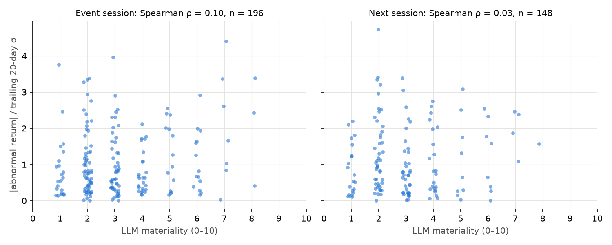

# Signal or Noise: eval results

Generated 2026-10-21 20:07 UTC by `eval/eval.py` from `eval/data/` (exported with `eval/export.sh`). Every number below comes from that run; nothing is edited by hand.

## Data

- **Source: live RSS only** (Yahoo per-ticker + CNBC), polled from 2026-10-20 23:21 UTC to 2026-10-21 19:54 UTC. No historical dataset is used, so there are no historical-dataset results to report separately.
- Scored by `claude-haiku-5-5` (prompt `v1`). Live headlines are only a clean test if they were published after the model's training cutoff; otherwise the model may already know what happened.
- 1346 scored stories, 687 with a primary ticker, collapsed to 98 ticker-sessions whose event session has closed; 98 of those have the 20-session volatility history needed to normalize.
- Prices: adjusted daily closes from yfinance, through 2026-10-20.

## Method

- **Unit:** one primary ticker × one event session; materiality is the max over its stories, the headline count is the sum of headlines the scorer saw, and direction comes from the top story.
- **Event session:** close before the scoring cutoff → next close after it. For headlines during market hours this window starts *before* the headline, so it measures the reaction, including moves that may have caused the news. **Next session** (the following close-to-close) is the clean predictive test.
- **Abnormal return** = stock − SPY, divided by the stock's standard deviation of abnormal returns over the 20 sessions before the event session. The target is the absolute value of that.
- **Spearman ρ** with a 2000-resample percentile bootstrap 95% CI (seed 0), resampling ticker-sessions. Baselines are tested on the same resamples, so the LLM − baseline difference has a CI.
- **Baseline (b)** matches the visible headlines against `\b(?:earnings|eps|quarterly results|q[1-4] (?:results|earnings))\b` (case-insensitive).

## Event session

n = 98 ticker-sessions.

| Predictor of \|normalized abnormal return\| | Spearman ρ | 95% CI | p |
|---|---|---|---|
| Materiality (LLM) | -0.003 | [-0.205, 0.195] | 0.980 |
| Headline count (baseline a) | -0.265 | [-0.471, -0.066] | 0.008 |
| Earnings keyword (baseline b) | 0.019 | [-0.185, 0.214] | 0.851 |

Materiality CI includes 0: no evidence that materiality predicts move size.

| LLM − baseline | Δρ | 95% CI | LLM beats it? |
|---|---|---|---|
| vs Headline count (baseline a) | 0.263 | [0.060, 0.464] | Δρ > 0 only because the baseline is lower; materiality's own CI includes 0 |
| vs Earnings keyword (baseline b) | -0.022 | [-0.273, 0.228] | not shown (CI includes 0) |

| Materiality quintile | n | Materiality range | Mean \|normalized abnormal return\| |
|---|---|---|---|
| Top | 20 | 4–8 | 0.77 |
| Bottom | 20 | 1–2 | 0.66 |

**Direction hit rate** (top story's direction ≠ 0): 14/36 = 38.9%, Wilson 95% CI [24.8%, 55.1%], binomial p = 0.243 vs 50%.

## Next session

n = 49 ticker-sessions.

| Predictor of \|normalized abnormal return\| | Spearman ρ | 95% CI | p |
|---|---|---|---|
| Materiality (LLM) | 0.019 | [-0.314, 0.334] | 0.899 |
| Headline count (baseline a) | -0.210 | [-0.484, 0.079] | 0.148 |
| Earnings keyword (baseline b) | 0.029 | [-0.280, 0.334] | 0.845 |

Materiality CI includes 0: no evidence that materiality predicts move size.

| LLM − baseline | Δρ | 95% CI | LLM beats it? |
|---|---|---|---|
| vs Headline count (baseline a) | 0.228 | [-0.116, 0.555] | not shown (CI includes 0) |
| vs Earnings keyword (baseline b) | -0.010 | [-0.339, 0.338] | not shown (CI includes 0) |

| Materiality quintile | n | Materiality range | Mean \|normalized abnormal return\| |
|---|---|---|---|
| Top | 10 | 4–6 | 0.87 |
| Bottom | 10 | 1–1 | 0.82 |

**Direction hit rate** (top story's direction ≠ 0): 8/14 = 57.1%, Wilson 95% CI [32.6%, 78.6%], binomial p = 0.791 vs 50%.

## Pipeline

- 3224 feed polls, 1 failed. LLM cost 0.3516 USD in total; p50 latency per (non-cached) LLM call 1800 ms.
- No fully covered day yet, so no per-day averages.

| ET date | Coverage | Headlines | Stories | LLM cost (USD) |
|---|---|---|---|---|
| 2026-10-14 | partial | 4 | 4 | 0.0000 |
| 2026-10-15 | partial | 18 | 18 | 0.0000 |
| 2026-10-16 | partial | 24 | 22 | 0.0000 |
| 2026-10-17 | partial | 8 | 8 | 0.0000 |
| 2026-10-18 | partial | 8 | 8 | 0.0000 |
| 2026-10-19 | partial | 179 | 174 | 0.0000 |
| 2026-10-20 | partial | 551 | 505 | 0.0582 |
| 2026-10-21 | partial | 736 | 612 | 0.2934 |

Partial days only contain what was still in the feeds at the first poll, or what was collected before the last poll. Cost is by the day the score was made, so the first day includes the backfill.

### Collection gaps

- 2026-10-21 00:26 → 2026-10-21 02:54 UTC (2.5 h without a poll)
- 2026-10-21 14:42 → 2026-10-21 18:03 UTC (3.4 h without a poll)

